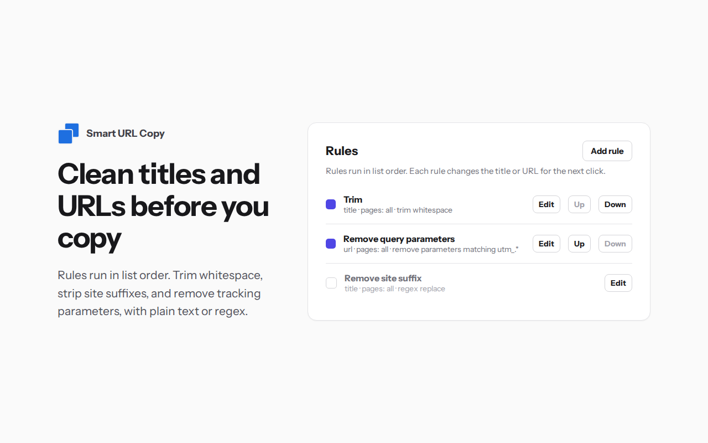

<p align="center">
  
</p>

<h1 align="center">Smart URL Copy</h1>

<p align="center">
  <a href="STORE_URL"></a>
  
  
</p>

<p align="center">
  Browser extension for Chrome-based browsers (Chrome, Brave). Requires Chrome 116 or newer.<br>
  Copy the page title and URL in your own format, such as a Markdown link.
</p>

## Features

| Icon | Feature |
|:---:|---|
|  | **One click copy.** Click the toolbar icon to copy a ready link. |
| 🧩 | **Templates.** Markdown, HTML or your own format. |
| ✂️ | **Rules.** Trim titles, strip tracking parameters, rewrite URLs. |
| 🎯 | **Per-page rules.** Apply a rule only to URLs matching a regex. |
|  /  | **Clear status.** Green check on success, red icon on failure. |
| 💾 | **Import and export.** Back up or move all settings as JSON. |
| 🔒 | **Private.** No network requests. Data stays in browser storage. |

## Feature examples

### One click copy

Click the toolbar icon, then paste:

```
[Smart URL Copy](https://github.com/pchomik/smart-url-copy)
```

The clipboard gets `text/plain` and `text/html` with the same text. Editors paste plain text; rich text apps paste a link.

### Templates

Use `{{ title }}` and `{{ url }}` as placeholders. Only one template is active.

- Markdown: `[{{ title }}]({{ url }})`
- HTML: `<a href="{{ url }}">{{ title }}</a>`

### Rules

Rules run in list order. Each rule can be turned on or off.

| Goal | Rule |
|---|---|
| Trim spaces in title | Target `title`, action *Trim* |
| Remove ` - Example` suffix | Target `title`, *Regex replace*, pattern ` - Example$`, empty replacement |
| Remove `utm_source` | Target `url`, *Remove query parameter*, name `utm_source` |
| Remove all `utm_*` | Same, name `utm_.*` with *Name is a regex* checked |
| Blog URL to site root | Target `url`, *Regex replace*, pattern `^(https://[^/]+)/blog/.*$`, replacement `{{ 1 }}/` |

Limit any rule to matching pages with a page URL pattern, for example `^https://example\.com/blog/`.

If a URL rule produces an invalid URL, the previous value is kept and a warning is shown.



### Status icon

| Icon | Meaning |
|:---:|---|
|  | Copied. Icon returns to default after 1 second. |
|  | Failed. Hover the icon within 1.5 seconds to read the reason. |

### Import and export

Open options (right-click the toolbar icon, then **Options**) to save all rules and templates to a JSON file, or restore them from one. An invalid file is rejected and changes nothing. Try [examples/settings.example.json](examples/settings.example.json).

### Restricted pages

On `chrome://` pages, the Chrome Web Store and some PDF viewers, the extension copies through a hidden offscreen document.

## Install

### Chrome Web Store

1. Open the [Smart URL Copy store page](STORE_URL).
2. Click **Add to Chrome**. Brave can install from the same page.

### From a release

1. Download `smart-url-copy-vX.Y.Z.zip` from the [Releases](../../releases) page and unzip it. Keep the folder.
2. Open `chrome://extensions` (or `brave://extensions`).
3. Enable **Developer mode**, then click **Load unpacked** and select the folder.

To update a manual install, replace the folder contents and click the reload icon on the Smart URL Copy card.

## Build

Requires Node.js LTS and npm.

```sh
npm install
npm run build
```

Output goes to `dist/`. Load `dist/` with **Load unpacked** as described above. Run tests with `npm test`.

## Troubleshooting

- **Red icon:** the copy failed. Hover the icon right after clicking to read the reason.
- **Change not in copy:** check that the rule is enabled, its page URL pattern matches, and the template is active.
- **Invalid settings:** the extension falls back to the default template and no rules. Import a valid settings file to restore your setup.

## More

- [Privacy policy](PRIVACY.md)
- [Changelog](CHANGELOG.md)
- [Security and support](SECURITY.md)

## License

MIT. See [LICENSE](LICENSE).
